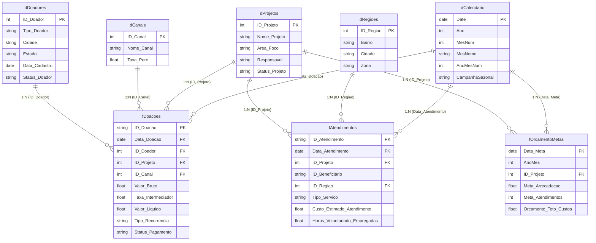

# 🤝 Projeto 5: Gestão Estratégica & Impacto Multi-Programas - Terceiro Setor

[](https://github.com)
[-purple?style=for-the-badge)](https://github.com)
[](https://github.com)

Ambiente analítico completo projetado para uma organização social de grande porte (**ONG Multi-Programas**), estruturado com **três tabelas fato integradas** e **quatro dimensões compartilhadas**, permitindo monitorar o ciclo completo do terceiro setor: captação financeira, planejamento orçamentário mensal e execução de impacto social nas comunidades assistidas.

---

## 🏛️ 1. Arquitetura Dimensional Multi-Fato (*Constellation Schema*)

Diferente de modelos simples, esta arquitetura conecta três tabelas fato independentes que compartilham dimensões conformadas, garantindo que métricas de arrecadação, impacto social e metas orçamentárias se cruzem sem criar nenhum relacionamento muitos-para-muitos (N:N).



---

## 📚 2. Dicionário de Dados

### 2.1. Fato Financeira: `fDoacoes.csv`
Registra cada aporte de recursos captado pela organização.

| Coluna | Tipo | Chave | Descrição |
| :--- | :--- | :---: | :--- |
| `ID_Doacao` | Texto | PK | Identificador exclusivo da transação (ex: `DOC-2025-000001`). |
| `Data_Doacao` | Data | FK | Data da doação (relaciona com `dCalendario[Date]`). |
| `ID_Doador` | Inteiro | FK | Chave estrangeira para `dDoadores`. |
| `ID_Projeto` | Inteiro | FK | Chave estrangeira para `dProjetos`. |
| `ID_Canal` | Inteiro | FK | Chave estrangeira para `dCanais`. |
| `Valor_Bruto` | Decimal | - | Valor nominal doado (PJ: R$ 5k a R$ 50k; PF: R$ 20 a R$ 250). |
| `Taxa_Intermediador` | Decimal | - | Custo percentual cobrado pela operadora de pagamento. |
| `Valor_Liquido` | Decimal | - | Montante líquido creditado na conta (`Valor_Bruto - Taxa`). |
| `Tipo_Recorrencia` | Texto | - | `Mensalista/Assinatura`, `Patrocínio Corporativo` ou `Única`. |
| `Status_Pagamento` | Texto | - | `Confirmado`, `Falha` ou `Estornado`. |

---

### 2.2. Fato de Impacto Social: `fAtendimentos.csv`
Registra os serviços de assistência prestados diretamente na ponta.

| Coluna | Tipo | Chave | Descrição |
| :--- | :--- | :---: | :--- |
| `ID_Atendimento` | Texto | PK | Código do atendimento realizado (ex: `ATD-2025-000001`). |
| `Data_Atendimento` | Data | FK | Data da ação social (relaciona com `dCalendario[Date]`). |
| `ID_Projeto` | Inteiro | FK | Chave estrangeira para `dProjetos`. |
| `ID_Beneficiario` | Texto | - | Identificador único anonimizado do cidadão assistido. |
| `ID_Regiao` | Inteiro | FK | Chave estrangeira para `dRegioes` (bairro/zona da ação). |
| `Tipo_Servico` | Texto | - | `Cesta Básica`, `Consulta Médica/Psicológica`, `Oficina de Capacitação`, `Apoio Jurídico`. |
| `Custo_Estimado_Atendimento` | Decimal | - | Custo financeiro unitário incorrido para viabilizar o atendimento. |
| `Horas_Voluntariado_Empregadas` | Decimal | - | Quantidade de horas de voluntariado dedicadas à ação. |

---

### 2.3. Fato de Planejamento: `fOrcamentoMetas.csv`
Tabela com granularidade mensal por projeto com o plano orçamentário e metas sociais aprovadas. Ancorada no dia 01 de cada mês para garantir relacionamento estrito 1:N com `dCalendario[Date]`.

| Coluna | Tipo | Chave | Descrição |
| :--- | :--- | :---: | :--- |
| `Data_Meta` | Data | FK | Primeiro dia do mês orçado no formato `YYYY-MM-01` (relaciona com `dCalendario[Date]` em 1:N). |
| `AnoMes` | Inteiro | - | Ano e mês do planejamento no formato `YYYYMM` (ex: `202501`). |
| `ID_Projeto` | Inteiro | FK | Chave estrangeira para `dProjetos`. |
| `Meta_Arrecadacao` | Decimal | - | Meta financeira orçada de captação de recursos no mês (R$). |
| `Meta_Atendimentos` | Inteiro | - | Meta programática de serviços sociais a serem entregues. |
| `Orcamento_Teto_Custos` | Decimal | - | Limite máximo permitido de desembolso para o projeto. |

---

### 2.4. Dimensões Cadastrais

- **`dProjetos`:** Cadastro de programas sociais com área de foco (`Infância`, `Profissionalização`, `Saúde Comunitária`, `Moradia`), coordenador responsável e situação cadastral (`Ativo` ou `Concluído`).
- **`dDoadores`:** Base de doadores com perfil `PF` ou `PJ`, localidade, histórico de cadastro e status de fidelização (`Ativo` ou `Inativo/Churn`).
- **`dCanais`:** Portais de entrada financeira (`Pix`, `Cartão Recorrente`, `Boleto`, `Evento Beneficente`, `Emenda Parlamentar / Edital`).
- **`dRegioes`:** Mapeamento geográfico de vulnerabilidade social com Bairro, Cidade e Zona (`Norte`, `Sul`, `Leste`, `Oeste`, `Rural`).

---

## 🎨 3. Plano de Layout em Duas Páginas (Power BI)

### 📄 Página 1: Saúde Financeira & Captação (*Fundraising*)
**Foco:** Diretoria Executiva, captação de recursos, liquidez e controle de metas orçamentárias.

```
┌──────────────────────────────────────────────────────────────────────────────┐
│ [Logo ONG Multi-Programas]      [Filtro: Período Ano/Mês]   [Filtro: Projeto]│
├─────────────────┬─────────────────┬──────────────────┬───────────────────────┤
│  KPI 1          │  KPI 2          │  KPI 3           │  KPI 4                │
│  Total          │  Ticket Médio   │  % Atingimento   │  % Churn              │
│  Arrecadado Líq.│  por Doador     │  Meta Captação   │  de Doadores          │
│  (Confirmado)   │  (Geral vs PJ)  │  (Verde / Verm.) │  (Perda Mensal)       │
├─────────────────┴─────────────────┴──────────────────┴───────────────────────┤
│ [Gráfico 1: Linha Temporal - Arrecadação Real vs Meta Orçada Mensal]         │
│ (Linha contínua azul: Realizado | Linha tracejada cinza: Meta fOrcamentoMetas) │
├────────────────────────────────────────────────────┬─────────────────────────┤
│ [Gráfico 2: Composição por Canal de Captação]      │ [Base: Matriz por       │
│ (Barras Horizontais: Pix vs Cartão vs Edital com   │  Projeto e Maiores      │
│ impacto de taxas retidas de intermediação)         │  Doadores PJ Apoiadores]│
└────────────────────────────────────────────────────┴─────────────────────────┘
```

---

### 📄 Página 2: Execução Social & Prestação de Contas (*Impacto*)
**Foco:** Conselho Fiscal, auditoria, patrocinadores corporativos e líderes comunitários.

```
┌──────────────────────────────────────────────────────────────────────────────┐
│ [Painel de Impacto & Governança Social]             [Filtro: Área de Atuação]│
├─────────────────┬─────────────────┬──────────────────┬───────────────────────┤
│  KPI 1          │  KPI 2          │  KPI 3           │  KPI 4                │
│  3.550          │  1.200          │  R$ 178,40       │  8.420 Horas          │
│  Total de       │  Beneficiários  │  Custo Médio por │  Voluntariado         │
│  Atendimentos   │  Únicos         │  Pessoa Atendida │  Mobilizado           │
├─────────────────┴─────────────────┴──────────────────┴───────────────────────┤
│ [Gráfico 1: Mapa / Barras de Atendimento por Região e Zona de Vulnerabilidade]│
│ (Zona Norte, Sul, Leste, Oeste e Rural comparando volume de entregas)        │
├────────────────────────────────────────────────────┬─────────────────────────┤
│ [Gráfico 2: Volume de Atendimentos por Área]       │ [Tabela de Prestação    │
│ (Infância vs Saúde vs Capacitação vs Moradia)      │  de Contas: Orçado vs   │
│                                                    │  Realizado por Projeto] │
└────────────────────────────────────────────────────┴─────────────────────────┘
```

---

## 🛠️ 4. Como Executar e Replicar Localmente

```bash
# Execução do pipeline autônomo em Python
python generate_ong_multiprogram_data.py
```

Os arquivos CSV validados são salvos em:
- `data/`
- `Projetos/Projeto - ONG Multi-Programas/data/`

O catálogo com todas as fórmulas DAX prontas para cópia encontra-se em [`DAX_MEASURES.md`](DAX_MEASURES.md).
