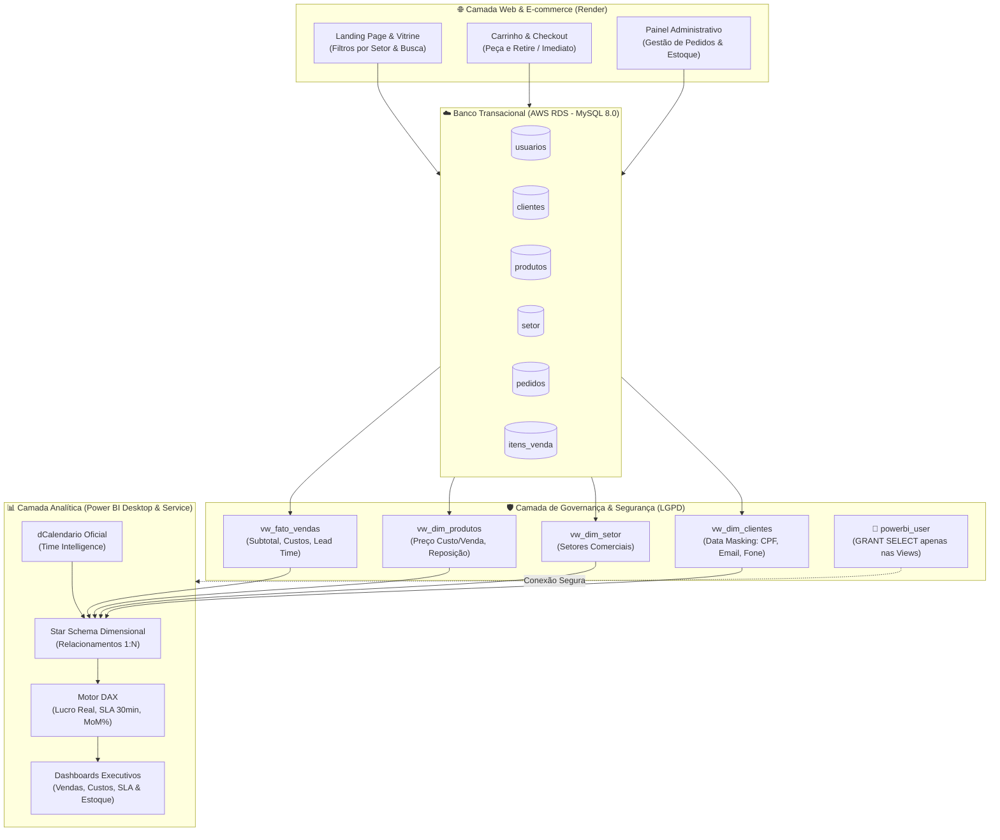
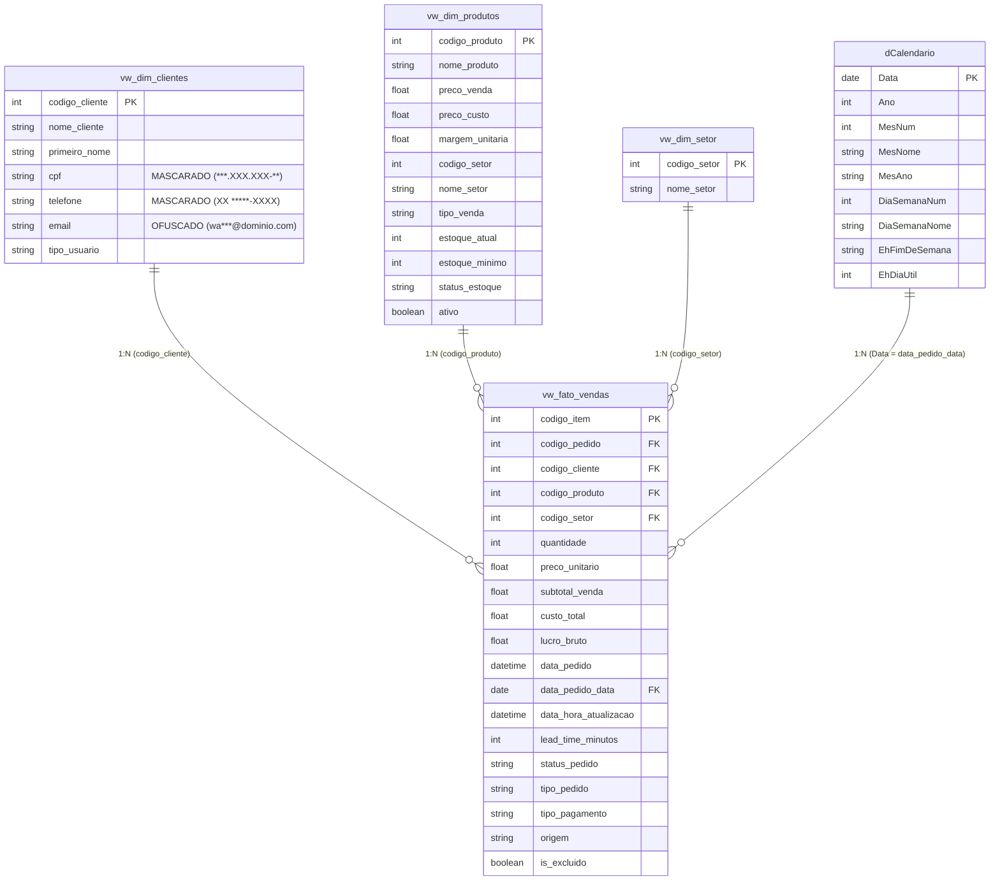

# 🥖 Projeto 6: Padaria Diniz (E-commerce Full-Stack, MySQL na AWS RDS & BI com Governança LGPD)

[](https://app.powerbi.com/view?r=eyJrIjoiZjEwNDJjZjgtNzY3NS00NWFjLThhYjEtYjU3YzgzMzA3NmYxIiwidCI6IjBhMGE3YmMxLWUxYTEtNDNjOS04MGYwLTY0YzEyMzVjY2M0OSJ9)
[](https://padaria-antigravity.onrender.com/padaria-landinpage.html)
[](https://aws.amazon.com/rds/)
[](views_powerbi_lgpd.sql)
[](DAX_MEASURES.md)

🔗 **[Clique aqui para interagir com o Dashboard Online](https://app.powerbi.com/view?r=eyJrIjoiZjEwNDJjZjgtNzY3NS00NWFjLThhYjEtYjU3YzgzMzA3NmYxIiwidCI6IjBhMGE3YmMxLWUxYTEtNDNjOS04MGYwLTY0YzEyMzVjY2M0OSJ9)**  
🌐 **Aplicação Web em Produção:** [**Padaria Diniz | O Sabor Artesanal da Região**](https://padaria-antigravity.onrender.com/padaria-landinpage.html)  
📊 **Arquivo Power BI (.pbix):** [`PowerBI - Padaria Diniz.pbix`](PowerBI%20-%20Padaria%20Diniz.pbix)  
📜 **Script SQL das Views & LGPD:** [`views_powerbi_lgpd.sql`](views_powerbi_lgpd.sql)  
📐 **Catálogo Completo de Medidas DAX:** [`DAX_MEASURES.md`](DAX_MEASURES.md)

---

## 🎯 1. Visão Geral do Projeto

A **Padaria Diniz** é uma solução *End-to-End* de comércio eletrônico e Business Intelligence desenvolvida para modernizar a operação de uma empresa regional do ramo de panificação e confeitaria artesanal. 

O projeto unifica:
1. **Front-End & E-commerce:** Interface moderna e responsiva com vitrine de produtos por setores (Padaria, Confeitaria, Frios, Bebidas, etc.), carrinho de compras inteligente, modal de agendamento de pedidos para a modalidade **"Peça e Retire"** e painéis administrativos para gestão de pedidos e estoque.
2. **Back-End & Banco de Dados em Nuvem:** API RESTful com persistência em banco relacional **MySQL 8.0 hospedado na nuvem AWS (Amazon RDS)**.
3. **Governança de Dados & LGPD:** Camada de views analíticas com *Data Masking* (mascaramento irreversível de CPF, telefone e e-mail) e usuário dedicado com **Princípio do Menor Privilégio (*Least Privilege*)**, impedindo o acesso do Power BI a senhas, hashes ou dados pessoais sensíveis.
4. **Business Intelligence no Power BI:** Modelagem dimensional em **Star Schema**, tabela calendário customizada e catálogo analítico com mais de **30 medidas DAX** cobrindo Faturamento Líquido, CMV, Lucro Real, Margem %, Lead Time/SLA de produção (30 min) e Time Intelligence (MoM e YTD).

---

## 🏛️ 2. Arquitetura da Solução (End-to-End)



---

## 🗄️ 3. Modelagem Dimensional (Star Schema)

No Power BI, as tabelas analíticas foram conectadas no formato **Star Schema** puro, garantindo desempenho de processamento em memória pelo motor VertiPaq:



---

## 🔒 4. Governança de Dados, Segurança & LGPD

Para estar em total conformidade com a **Lei Geral de Proteção de Dados (Lei nº 13.709/2018)** e as melhores práticas corporativas de segurança da informação:

1. **Ofuscação e Anonimização de Dados (*Data Masking*):**
   - O Power BI **não acessa** o número integral de CPF, telefone ou e-mail dos clientes.
   - Regras aplicadas diretamente na view SQL:
     ```sql
     -- Ofuscação de CPF (exibe apenas os dígitos centrais):
     CONCAT('***.', SUBSTRING(c.cpf, 5, 7), '-**') AS cpf
     
     -- Mascaramento de Telefone:
     CONCAT(SUBSTRING(c.telefone, 1, 5), ' *****-', RIGHT(c.telefone, 4)) AS telefone
     
     -- Ofuscação de E-mail:
     CONCAT(LEFT(u.email, 2), '***@', SUBSTRING_INDEX(u.email, '@', -1)) AS email
     ```
2. **Princípio do Menor Privilégio (*Least Privilege*):**
   - O usuário de conexão `powerbi_user` possui permissões estritamente restritas de leitura (`GRANT SELECT`) nas 4 views analíticas.
   - Tabelas contendo senhas, credenciais de autenticação, tokens ou dados operacionais brutos são **completamente inacessíveis** para o conector do BI.

---

## 📊 5. Principais Indicadores e Métricas DAX

O modelo conta com mais de 30 medidas estruturadas organizadas em pastas temáticas no arquivo [`DAX_MEASURES.md`](DAX_MEASURES.md):

| Grupo Temático | Principais Medidas DAX | Objetivo de Negócio |
| :--- | :--- | :--- |
| **Faturamento** | `[Receita Bruta]`, `[Receita Faturada]`, `[Receita em Aberto]`, `[Receita Cancelada]` | Visibilidade da esteira de pedidos: retirados, em produção e perdas financeiras por cancelamento. |
| **Lucratividade** | `[Custo Total (CMV)]`, `[Lucro Real]`, `[Margem de Lucro Real %]`, `[Markup Médio %]` | Análise real de rentabilidade deduzindo os insumos de panificação e confeitaria. |
| **SLA & Operação** | `[Lead Time Médio de Preparo]`, `[Meta Lead Time (30 min)]`, `[% Pedidos no Prazo]` | Monitoramento da velocidade da cozinha/balcão para garantir que o cliente não espere além do acordado. |
| **Peça e Retire** | `[Qtd Pedidos Agendados]`, `[Qtd Agendados para Hoje]` | Previsão de demanda diária para a equipe de produção do turno matutino/vespertino. |
| **Time Intelligence** | `[Receita Mês Anterior]`, `[Crescimento MoM %]`, `[Receita YTD]` | Comparabilidade temporal de evolução da microempresa. |
| **Estoque** | `[Estoque Total]`, `[Qtd Produtos Esgotados]`, `[Qtd Produtos em Alerta]` | Prevenção de rupturas em produtos de alto giro (ex.: pão francês, queijo muçarela). |

### Destaque de DAX: Eficiência de SLA (Lead Time de Preparo)

```dax
% Pedidos no Prazo = 
VAR MetaMinutos = [Meta Lead Time] -- SLA acordado: 30 minutos
RETURN
DIVIDE (
    CALCULATE (
        DISTINCTCOUNT ( vw_fato_vendas[codigo_pedido] ),
        vw_fato_vendas[status_pedido] = "Finalizado",
        vw_fato_vendas[is_excluido] = FALSE (),
        FILTER (
            vw_fato_vendas,
            vw_fato_vendas[lead_time_minutos] <= MetaMinutos
        )
    ),
    [Qtd Pedidos Finalizados],
    0.0
)
```

---

## 🛠️ 6. Como Executar e Replicar

1. **Interagir com o Dashboard Online:**
   - Acesse o relatório publicado no [Power BI Service](https://app.powerbi.com/view?r=eyJrIjoiZjEwNDJjZjgtNzY3NS00NWFjLThhYjEtYjU3YzgzMzA3NmYxIiwidCI6IjBhMGE3YmMxLWUxYTEtNDNjOS04MGYwLTY0YzEyMzVjY2M0OSJ9) para testar os filtros dinâmicos de setor, KPIs de faturamento e análise de SLA de preparo.
2. **Acessar a Aplicação Web:**
   - Navegue até [Padaria Diniz Online](https://padaria-antigravity.onrender.com/padaria-landinpage.html) para experimentar o catálogo de produtos, o fluxo de pedidos e o design da interface.
3. **Executar o Script SQL no Banco:**
   - Execute o script [`views_powerbi_lgpd.sql`](views_powerbi_lgpd.sql) em seu ambiente MySQL para provisionar as views e o usuário analítico.
4. **Explorar o Arquivo Power BI (.pbix):**
   - Abra o arquivo [`PowerBI - Padaria Diniz.pbix`](PowerBI%20-%20Padaria%20Diniz.pbix) no **Power BI Desktop**.
   - Os dados já estão importados e o modelo relacional está configurado com todas as medidas, formatações e colunas calculadas de calendário.
