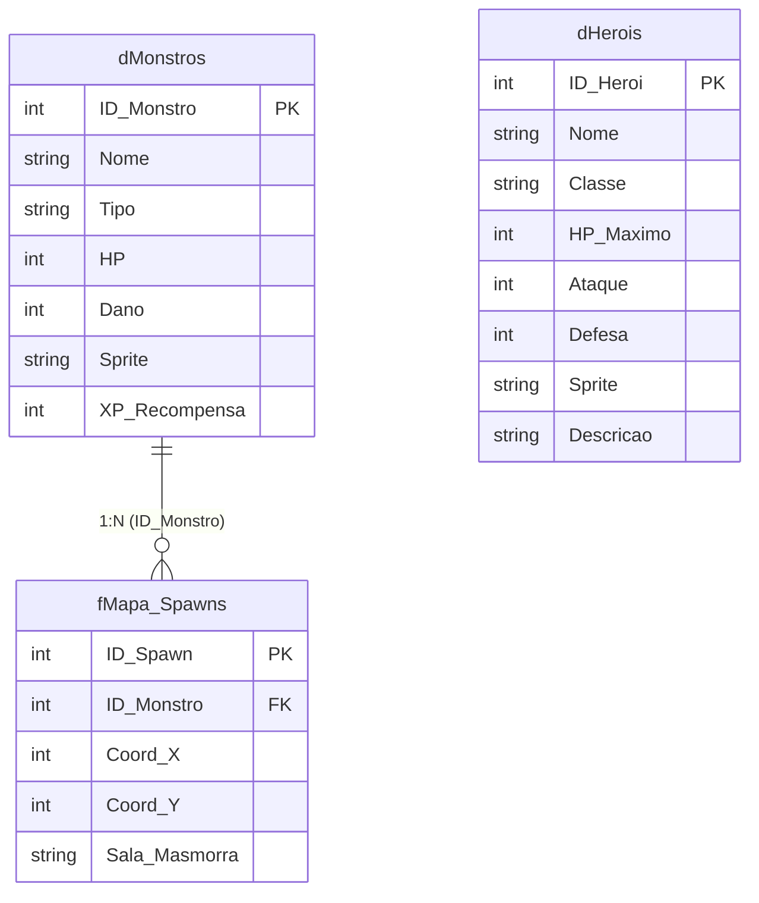

# 🗡️ Projeto 6: RPG Dungeon Crawler Jogável no Power BI Desktop

[](https://github.com)
[](https://github.com)
[](https://github.com)
[](https://github.com)
[](https://github.com)

Projeto inovador de engenharia analítica e desenvolvimento front-end avançado: um **RPG Dungeon Crawler 2D jogável** com temática de Fantasia Medieval executado **100% dentro do Power BI Desktop** utilizando o visual certificado **HTML Content** (por Daniel Marsh-Patrick).

O motor do jogo combina **Modelagem Dimensional Star Schema**, **Compilação Just-in-Time em DAX** e **Renderização nativa via HTML5 Canvas API**, com detecção de colisão em grid 32x32, combate por turnos, sistema de classes com sprites dinâmicos, persistência de estado segura e controles híbridos (teclado e D-Pad na tela)!

---

## 🏛️ 1. Arquitetura da Solução & Star Schema

O jogo é alimentado por uma modelagem dimensional gerada via script Python autônomo ([`gerar_banco_rpg.py`](../../gerar_banco_rpg.py)):



> ⚠️ **Regra Fundamental de Modelagem:**
> - `dMonstros` conecta-se a `fMapa_Spawns` em relação **1 para Muitos (1:\*)**.
> - `dHerois` é uma **Tabela Desconectada (*Disconnected Table*)**. Ela **NÃO** deve ser relacionada a nenhuma tabela no modelo. O herói é selecionado via Slicer e seus atributos são injetados no motor via `SELECTEDVALUE()` no DAX!

---

## 📚 2. Dicionário de Dados do Ecossistema RPG

### 2.1. Dimensão de Heróis Jogáveis: `dHerois.csv`
Armazena as classes medievais disponíveis para o jogador selecionar no Power BI:

| ID | Herói | HP | Ataque | Defesa | Sprite | Especialidade / Perfil |
| :-: | :--- | :-: | :-: | :-: | :---: | :--- |
| **1** | **Guerreiro** | 150 | 25 | 20 | `dummyimage...GUE` | Alta resistência física e equilíbrio combate |
| **2** | **Mago** | 80 | 45 | 10 | `dummyimage...MAG` | Altíssimo dano destrutivo, baixa vitalidade |
| **3** | **Ladino** | 100 | 35 | 15 | `dummyimage...LAD` | Alta velocidade e precisão crítica |
| **4** | **Clérigo** | 120 | 15 | 25 | `dummyimage...CLE` | Tanque defensivo com bênçãos sagradas |

---

### 2.2. Dimensão de Inimigos: `dMonstros.csv`
Contém o bestiário da masmorra com stats de combate e identificador de Boss:

| ID | Nome do Inimigo | Categoria | HP | Dano | Sprite |
| :-: | :--- | :---: | :-: | :-: | :---: |
| **1** | **Slime Verde** | Comum | 30 | 5 | `SLI (32x32)` |
| **2** | **Goblin** | Comum | 50 | 10 | `GOB (32x32)` |
| **3** | **Esqueleto** | Morto-Vivo | 60 | 15 | `ESQ (32x32)` |
| **4** | **Orc Guerreiro** | Elite | 90 | 20 | `ORC (32x32)` |
| **5** | **Dragão Ancião (Boss)** | Chefe Final | 300 | 40 | `BOSS (64x64)` |

---

### 2.3. Fato de Spawns da Masmorra: `fMapa_Spawns.csv`
Mapeia a posição exata de cada criatura no grid de 800x600 pixels (múltiplos de 32):
- **Zona de Início do Herói:** `X=32, Y=32` (garantidamente desobstruída).
- **Câmara do Chefe:** `X=704, Y=64` (Dragão Ancião de 64x64).
- **15 Inimigos Comuns:** Distribuídos pelas câmaras e corredores estratégicos.

---

## ⚙️ 3. A Engenharia do Jogo: Como Funciona o Middleware DAX

```
┌─────────────────────────────────┐
│  Segmentador de Heróis          │ (Filtro Power BI: dHerois[Nome])
└──────────────┬──────────────────┘
               ▼
┌─────────────────────────────────┐
│  Medida DAX: [RPG_HTML_Engine]  │
│  - Captura Atributos do Herói   │
│  - Serializa Monstros em JSON   │
│  - Injeta HTML5, CSS e JS       │
└──────────────┬──────────────────┘
               ▼
┌─────────────────────────────────┐
│  Visual: HTML Content           │
│  - Renderiza <canvas> 800x600   │
│  - Executa o Game Loop JS       │
│  - Persiste via Safe Storage    │
└─────────────────────────────────┘
```

1. **Serialização Declarativa em DAX (Sintaxe Corrigida):**
   A função `CONCATENATEX` itera sobre `fMapa_Spawns`, buscando atributos com `LOOKUPVALUE` inline (sem declarar `VAR` internos que quebram o parser do DAX) e montando o array JSON em tempo de execução:
   ```javascript
   [{id: 1, idMonstro: 1, nome: 'Slime Verde', x: 128, y: 96, hp: 30, dano: 5, sprite: '...'}, ...]
   ```
2. **Eliminação de `alert()` por HUD In-Game:**
   Como o visual roda em `<iframe>` protegido sem a flag `allow-modals`, o motor utiliza um HUD de mensagens de batalha em tempo real (`#combatLog`) e modal estilizado in-canvas para vitória épica e queda em batalha, garantindo que o jogo nunca trave!
3. **Persistência Segura com `Safe Storage`:**
   Ao trocar de classe no segmentador lateral do Power BI (ex: de *Guerreiro* para *Mago*), o script lê a posição salva com tratamento `try/catch` e fallback em memória `window`, permitindo trocar de herói sem perder a posição na masmorra!
4. **Controles Híbridos (Teclado + Botões Direcionais):**
   O jogador pode navegar com as **Setas Direcionais** ou **W, A, S, D** no teclado, ou clicando nos botões `⬆️`, `⬇️`, `⬅️`, `➡️` integrados no topo do visual.

---

## 🚀 4. Guia Definitivo de Implementação no Power BI Desktop

Siga estes passos exatos para colocar o RPG para rodar sem nenhum erro de sintaxe:

### Passo 1: Ingestão dos Dados via Power Query
1. No Power BI Desktop, clique em **Página Inicial** $\rightarrow$ **Obter Dados** $\rightarrow$ **Texto/CSV**.
2. Carregue os 3 arquivos da pasta `Projetos/Projeto - RPG Dungeon Crawler/data/`:
   - `dHerois.csv`
   - `dMonstros.csv`
   - `fMapa_Spawns.csv`
3. ⚠️ **Atenção nas Configurações da Janela de Importação:**
   - **Delimitador:** Selecione **Ponto e vírgula (;)**.
   - **Origem do Arquivo:** Selecione **65001: Unicode (UTF-8)** (para garantir acentuação correta de Guerreiro, Clérigo e Dragão Ancião).
4. Clique em **Carregar**.

---

### Passo 2: Configurar o Modelo de Dados (Relacionamento)
1. Vá para a exibição de **Modelo** (ícone de relacionamentos à esquerda).
2. Conecte:
   - `dMonstros[ID_Monstro]` (1) $\longrightarrow$ `fMapa_Spawns[ID_Monstro]` (*)
   - Cardinalidade: **1 para muitos (1:\*)**
   - Direção do filtro cruzado: **Única**
   - Ativo: **Sim**
3. 🛑 **NÃO conecte a tabela `dHerois`:** Ela deve ficar solta (desconectada) no diagrama de relacionamento.

---

### Passo 3: Importar o Visual "HTML Content"
1. No painel de **Visualizações** (lado direito), clique no botão de três pontinhos (**`...`**) $\rightarrow$ **Obter mais visuais** (*Get more visuals*).
2. Na barra de pesquisa, digite **`HTML Content`**.
3. Localize o visual criado por **Daniel Marsh-Patrick** (certificado pela Microsoft e gratuito) e clique em **Adicionar**.

---

### Passo 4: Criar a Medida DAX do Motor
1. Clique com o botão direito na tabela `fMapa_Spawns` e selecione **Nova Medida**.
2. Abra o arquivo [`DAX_MEASURES.md`](DAX_MEASURES.md).
3. Copie o código integral da medida **`RPG_HTML_Engine`** e cole na barra de fórmulas do Power BI Desktop.
4. Pressione **Enter**.

---

### Passo 5: Montar o Layout na Tela
1. **Adicionar o Jogo:**
   - Clique no ícone do visual **HTML Content** para adicioná-lo à página.
   - Arraste a medida **`[RPG_HTML_Engine]`** para o campo **"Values"** do visual.
   - Redimensione o visual para:
     - **Largura:** ~`850 px`
     - **Altura:** ~`710 px`
2. **Adicionar o Seletor de Heróis (Troca de Classe em Tempo Real):**
   - Adicione uma **Segmentação de Dados** (*Slicer*).
   - Arraste o campo `dHerois[Nome]` para ela.
   - No painel de formatação do slicer $\rightarrow$ *Configurações da segmentação* $\rightarrow$ *Estilo*: escolha **Bloco (*Tile*)** ou **Linha Horizontal**.
3. **Adicionar Cards Analíticos de RPG (Opcional):**
   - Crie cartões com as medidas complementares de [`DAX_MEASURES.md`](DAX_MEASURES.md):
     - `[Herói Atual]`
     - `[Poder de Ataque]`
     - `[Poder de Defesa]`
     - `[HP Máximo Herói]`
     - `[Total de Monstros Ativos]`

---

## 🎮 5. Como Jogar

1. **Ativar o Foco:** Clique uma vez com o mouse dentro da masmorra para que o navegador direcione o teclado para o jogo.
2. **Mover o Herói:**
   - Use as **Setas Direcionais do Teclado** (`⬆️`, `⬇️`, `⬅️`, `➡️`) ou as teclas **W, A, S, D**.
   - Ou clique nos botões direcionais no topo da tela!
3. **Batalhar:** Mova seu herói para a mesma célula de um monstro para atacar. O dano causado e o contra-ataque do monstro aparecerão na barra de log em tempo real!
4. **Troca de Classe Instantânea:** Clique em *Guerreiro*, *Mago*, *Ladino* ou *Clérigo* no filtro lateral do Power BI a qualquer momento. Seus atributos e sprite mudarão instantaneamente, mantendo a sua posição salva na masmorra!
5. **Derrotar o Boss:** Atravesse a masmorra até a câmara no canto superior direito (`X=704, Y=64`) e derrote o temível Dragão Ancião!
6. **Reiniciar a Masmorra:** Clique no botão dourado **"🔄 Reset"** no topo da tela do jogo.

---

## 🛠️ Como Executar o Pipeline Localmente

```bash
# Executar a geração das tabelas e validação de integridade
python gerar_banco_rpg.py
```
