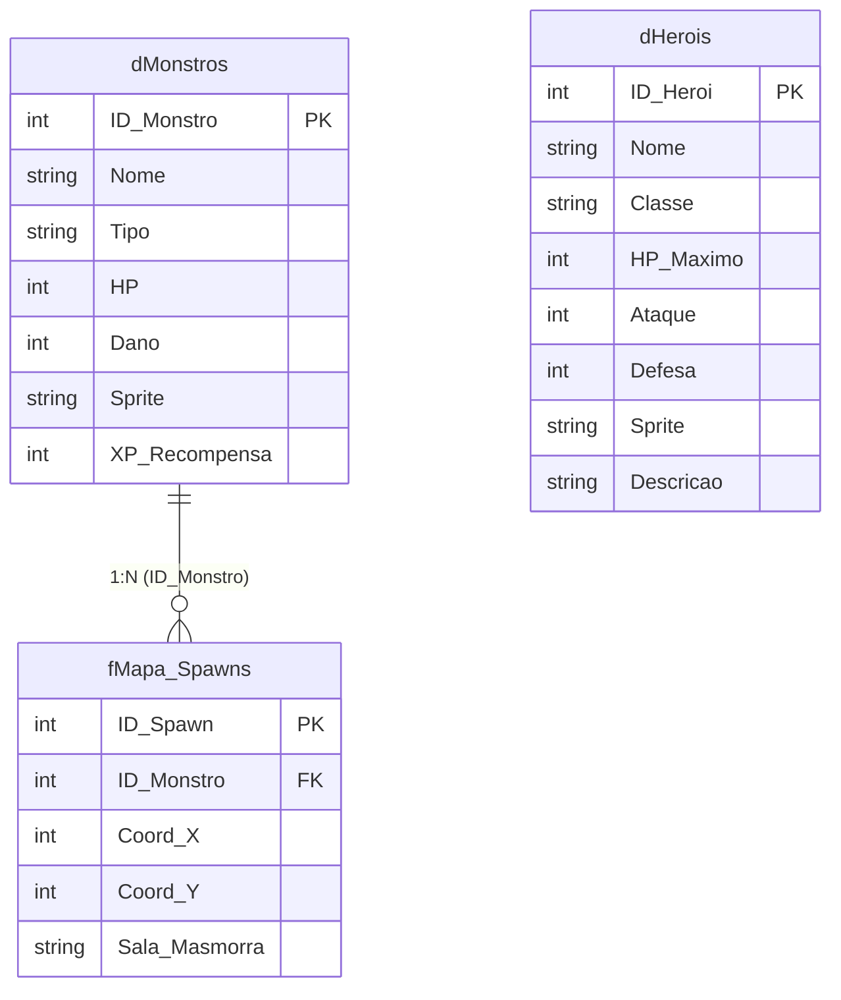

# 🗡️ Projeto 6: RPG Dungeon Crawler Jogável no Power BI Desktop

[](https://github.com)
[](https://github.com)
[](https://github.com)
[](https://github.com)
[](https://github.com)

Projeto inovador de engenharia analítica e desenvolvimento front-end avançado: um **RPG Dungeon Crawler 2D jogável** com temática de Fantasia Medieval executado **100% dentro do Power BI Desktop** utilizando o visual certificado **HTML Content** (por Daniel Marsh-Patrick).

O motor do jogo combina **Modelagem Dimensional Star Schema**, **Compilação Just-in-Time em DAX** e **Renderização nativa via HTML5 Canvas API**, com detecção de colisão em grid 32x32, combate por turnos, sistema de classes com sprites dinâmicos e persistência de estado via `localStorage`!

---

## 🏛️ 1. Arquitetura da Solução & Star Schema

O jogo é alimentado por uma modelagem dimensional rigorosa gerada via script Python autônomo ([`gerar_banco_rpg.py`](../../gerar_banco_rpg.py)):



---

## 📚 2. Dicionário de Dados do Ecossistema RPG

### 2.1. Dimensão de Heróis Jogáveis: `dHerois.csv`
Armazena as classes medievais disponíveis para o jogador selecionar no Power BI:

| ID | Herói | HP | Ataque | Defesa | Sprite | Especialidade / Perfil |
| :-: | :--- | :-: | :-: | :-: | :---: | :--- |
| **1** | **Guerreiro** | 150 | 25 | 20 | `dummyimage...GUE` | Alta resistência física e equilíbrio combate |
| **2** | **Mago** | 80 | 45 | 10 | `dummyimage...MAG` | Altíssimo dano destrutivo, baixa vitalidade |
| **3** | **Ladino** | 100 | 35 | 15 | `dummyimage...LAD` | Alta velocidade e precisão crítica |
| **4** | **Clérigo** | 120 | 15 | 25 | `dummyimage...CLE` | Tanque defensivo com bênçãos sagradas |

---

### 2.2. Dimensão de Inimigos: `dMonstros.csv`
Contém o bestiário da masmorra com stats de combate e identificador de Boss:

| ID | Nome do Inimigo | Categoria | HP | Dano | Sprite |
| :-: | :--- | :---: | :-: | :-: | :---: |
| **1** | **Slime Verde** | Comum | 30 | 5 | `SLI (32x32)` |
| **2** | **Goblin** | Comum | 50 | 10 | `GOB (32x32)` |
| **3** | **Esqueleto** | Morto-Vivo | 60 | 15 | `ESQ (32x32)` |
| **4** | **Orc Guerreiro** | Elite | 90 | 20 | `ORC (32x32)` |
| **5** | **Dragão Ancião (Boss)** | Chefe Final | 300 | 40 | `BOSS (64x64)` |

---

### 2.3. Fato de Spawns da Masmorra: `fMapa_Spawns.csv`
Mapeia a posição exata de cada criatura no grid de 800x600 pixels (múltiplos de 32):
- **Zona de Início do Herói:** `X=32, Y=32` (garantidamente desobstruída).
- **Câmara do Chefe:** `X=704, Y=64` (Dragão Ancião de 64x64).
- **15 Inimigos Comuns:** Distribuídos pelas câmaras e corredores estratégicos.

---

## ⚙️ 3. A Engenharia do Jogo: Como Funciona o Middleware DAX

```
┌───────────────────────────────┐
│  Segmentador de Heróis        │ (Filtro Power BI: dHerois[Nome])
└──────────────┬────────────────┘
               ▼
┌───────────────────────────────┐
│  Medida DAX: [RPG_HTML_Engine]│
│  - Captura Atributos do Herói │
│  - Serializa Monstros em JSON │
│  - Injeta HTML5, CSS e JS     │
└──────────────┬────────────────┘
               ▼
┌───────────────────────────────┐
│  Visual: HTML Content         │
│  - Renderiza <canvas> 800x600 │
│  - Executa o Game Loop JS     │
│  - Persiste via localStorage  │
└───────────────────────────────┘
```

1. **Serialização Declarativa em DAX:**
   A função `CONCATENATEX` itera sobre `fMapa_Spawns`, buscando atributos com `LOOKUPVALUE` e montando um array de objetos JavaScript em tempo de execução:
   ```javascript
   [{id: 1, nome: 'Slime Verde', x: 128, y: 96, hp: 30, dano: 5, sprite: 'url...'}, ...]
   ```
2. **Persistência de Estado com `localStorage`:**
   Ao trocar de classe no segmentador lateral do Power BI (ex: de *Guerreiro* para *Mago*), o Power BI recalcula a medida DAX. O script lê a posição salva no navegador (`localStorage.getItem('heroiX')` e `heroiY`), impedindo que a masmorra reinicie do zero!
3. **Detecção de Colisão & Combate:**
   A cada movimento (teclas direcionais ⬆️ ⬇️ ⬅️ ➡️ ou WASD), o motor valida os limites da masmorra (paredes perimetrais) e verifica se há um monstro vivo na mesma coordenada `(X, Y)`. O combate ocorre por cálculo de ataque do herói versus defesa e contra-ataque do monstro com alertas interativos!

---

## 🚀 4. Guia de Montagem no Power BI Desktop

### Passo 1: Ingestão dos Dados
1. No Power BI Desktop, clique em **Obter Dados** $\rightarrow$ **Texto/CSV**.
2. Carregue os 3 arquivos da pasta `data/`:
   - `dHerois.csv`
   - `dMonstros.csv`
   - `fMapa_Spawns.csv`
3. Na exibição de **Modelo**, crie o relacionamento:
   - `dMonstros[ID_Monstro]` (1) $\rightarrow$ `fMapa_Spawns[ID_Monstro]` (*) [Filtro Único, Ativo].

---

### Passo 2: Importar o Visual "HTML Content"
1. No painel de **Visualizações**, clique nos três pontinhos (`...`) $\rightarrow$ **Obter mais visuais** (*Get more visuals*).
2. Na barra de pesquisa, digite **`HTML Content`** (autor: *Daniel Marsh-Patrick* - visual gratuito e certificado pela Microsoft).
3. Clique em **Adicionar**.

---

### Passo 3: Criar a Medida do Motor
1. Clique em **Nova Medida**.
2. Copie e cole o código completo da medida **`[RPG_HTML_Engine]`** disponível no arquivo [`DAX_MEASURES.md`](DAX_MEASURES.md).
3. Pressione Enter.

---

### Passo 4: Montagem do Dashboard
1. **Visual do Jogo:**
   - Adicione o visual **HTML Content** na tela.
   - Arraste a medida **`[RPG_HTML_Engine]`** para o campo **"Values"**.
   - Ajuste o tamanho do visual para **Largura: 850px** e **Altura: 720px**.
2. **Segmentador de Heróis (Troca de Classe em Tempo Real):**
   - Adicione uma **Segmentação de Dados** (*Slicer*).
   - Arraste o campo `dHerois[Nome]`.
   - Configure o estilo para **Blocos / Botões Horizontais**.
3. **Cards de Status (Opcional):**
   - Adicione cartões com as medidas analíticas: `[Poder de Ataque]`, `[Poder de Defesa]`, `[HP Máximo Herói]` e `[Golpes Estimados Boss]`.

---

## 🎮 5. Controles do Jogo

- **Mover:** Use as **Setas Direcionais do Teclado** (`⬆️`, `⬇️`, `⬅️`, `➡️`) ou as teclas **W, A, S, D**.
- **Combate:** Mova o herói para a mesma célula de um monstro para desferir um ataque.
- **Troca de Classe:** Clique no filtro do Power BI para mudar instantaneamente entre Guerreiro, Mago, Ladino e Clérigo.
- **Reiniciar:** Clique no botão dourado **"🔄 Reiniciar Masmorra"** no topo da tela do jogo.

---

## 🛠️ Como Executar o Pipeline Localmente

```bash
# Executar a geração das tabelas e validação de integridade
python gerar_banco_rpg.py
```
